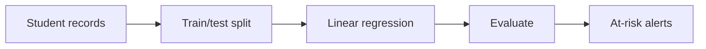

# Student Performance Predictor

> Flags at-risk students by mid-term, while there's still time to help, with the reasons a teacher can act on.

     

**Sector:** Education & Machine Learning  ·  **Project 24 of 50** in my [AI Automation Projects series](https://github.com/Princewill106/Princewill106)

## The problem

Schools find out a student is failing when the final results come out. By then it's too late. The early signals (falling attendance, missed assignments) are in the data weeks before.

## How it works



1. **Data** — Each row has attendance %, assignments completed %, mid-term score, weekly study hours and the final score (`sample_students.csv`).
2. **Split** — Data is split 80/20 into training and test sets with a fixed seed.
3. **Train** — Multiple linear regression is solved with the normal equation (Gauss-Jordan elimination, pure Python).
4. **Evaluate** — R² and mean absolute error are reported on the test set, plus each feature's coefficient.
5. **Act** — Current students below the pass mark are flagged, with the weakest contributing factor named.

## Features

- Linear regression from scratch (no NumPy)
- Train/test split and R²/MAE metrics
- Readable coefficients
- At-risk flags with the main contributing factor
- Predict for new students from CSV

## Quick start

```bash
git clone https://github.com/Princewill106/student-performance-predictor.git
cd student-performance-predictor
python make_sample.py && python main.py --demo
```

No installs needed: it uses only the Python standard library. The demo runs fully offline using the sample data in this repo.

**Optional: plug in an LLM.** Copy `.env.example` to `.env` and add an Anthropic or OpenAI key. The project will then use the model for the language-heavy steps and fall back to its rule-based logic if a call fails.

Run the tests:

```bash
python -m unittest -v
```

## Sample output

```text

```

## Use it in n8n (no code needed)

[`n8n-workflow.json`](n8n-workflow.json) is a ready-to-import n8n version of this project, built for n8n 1.x.

1. In n8n, open **Workflows → Import from File** and choose `n8n-workflow.json`.
2. Click **Test workflow**. It runs the full logic on the sample data built into the *Sample data* node, so you can see the results before connecting anything.
3. Open each output node and connect your accounts: Gmail (OAuth2), Google Sheets (OAuth2). For Google Sheets, pick your spreadsheet and sheet.
4. Adjust the settings at the top of the **Logic** node (thresholds, templates, contacts), then **Activate**.

**Flow:** **Schedule (Mondays 7am)** → Read current students → **Logic** (Code node)

**Outputs:**
- Email form teachers

The Logic node is a JavaScript port of the rules in `main.py`, so you can run the project in n8n without Python.

## Use it on your own data

Provide historic data with the same columns as `sample_students.csv`, and current students in `current_students.csv` (no final score). Run `python main.py`. The sample data is generated by `make_sample.py` (run it once before the demo).

## Project structure

```text
n8n-workflow.json            Importable n8n workflow
.env.example                 Optional API key settings
.gitignore                   Git ignore rules
LICENSE                      MIT license
README.md                    This file
current_students.csv         Reference / config data
llm.py                       Optional LLM helper (offline fallback)
main.py                      Entry point and core logic
make_sample.py               Supporting file
requirements.txt             Dependencies (stdlib only)
sample_students.csv          Sample input data for the demo
test_main.py                 Unit tests
```

## Who this is for

- School heads and form teachers
- Learning analytics students
- Bootcamps tracking learner progress

## Ideas to extend it

- [ ] Logistic model for pass/fail probability
- [ ] Power BI dashboard export
- [ ] Weekly parent alerts
- [ ] Compare with tree-based models

## About

Built by **Ogbu Ugochukwu Princewill**, AI Automation Lead and robotics engineer. I teach people and businesses to build with AI, not just talk about it. [LinkedIn](https://www.linkedin.com/in/ugochukwu-ogbu-653a0816a)

If this helped you, give it a ⭐ and share what you built with it.

## License

MIT — see [LICENSE](LICENSE).
